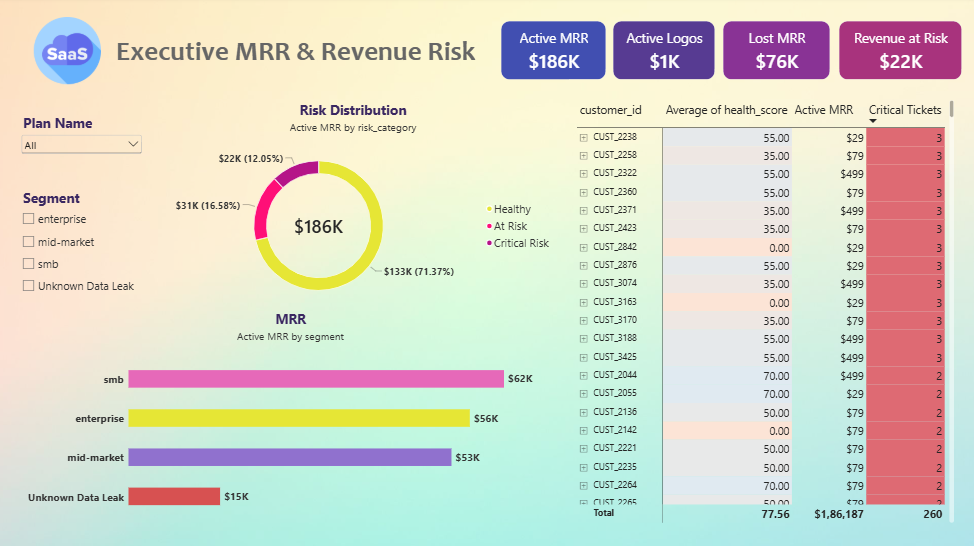

# B2B SaaS Customer Churn Data Warehouse & Analytics

[]()
[]()
[]()

Dashboard Preview


## The Business Problem
For B2B SaaS companies, retaining Enterprise customers is more cost-effective than acquiring new ones. However, Account Managers often lack visibility into technical and financial warning signs until a customer has already cancelled. 

This project solves that problem by building a production-grade **Medallion Data Architecture**. It extracts raw, messy subscription data, engineers a predictive **Customer Health Score**, and serves actionable intelligence to the Go-To-Market (GTM) team via an interactive dashboard—empowering them to proactively defend **$186K in Active MRR**.

## Tech Stack & Skills Demonstrated
* **Database & Warehousing (PostgreSQL):** Advanced SQL, DDL, Relational Integrity (PK/FK Constraints), CTEs, Views, Orphan Record Resolution.
* **Data Engineering (Python):** Pandas, SQLAlchemy, ETL/ELT pipelines, String Anomaly Cleaning, Business Feature Engineering.
* **BI & Analytics (Power BI):** Dimensional Modeling (Star Schema), DAX (`SUMX`, `RELATED`, `CALCULATE`), Cross-Filtering, UI/UX Information Hierarchy.

## Pipeline Architecture (End-to-End Workflow)

### 1. Ingestion & Quality Audit
* Ingested 6 raw CSV tables (`dim_customers`, `dim_plans`, `fct_subscriptions`, `fct_payments`, `fct_usage`, `fct_support`) into a PostgreSQL `raw_staging` schema.
* Built auditing scripts using `UNION ALL` to detect critical data defects, uncovering 50 duplicate customers, 23 time-travel subscriptions, and 359 broken foreign keys (trailing spaces).

### 2. Python Transformation & Feature Engineering
* Developed a Pandas ELT script (`etl_cleaning_and_scoring.py`) to programmatically strip string anomalies and drop logical impossibilities (e.g., negative payments).
* **Engineered a Customer Health Score (0–100):** Wrote logic to heavily penalize accounts for failed payments (-20 points) and high-severity support tickets (-15 points), categorizing the remaining score into `Healthy`, `At Risk`, or `Critical Risk`.

### 3. Data Warehouse Modeling (PostgreSQL)
* Architected the production `analytics` schema.
* Resolved severe relational integrity roadblocks (`SQL state: 23503`) by executing a "Dummy Insert" workflow to rescue 121 orphaned subscription records, recovering thousands in unmapped MRR.
* Locked the Star Schema using strict Primary and Foreign keys, and materialized the complex join logic into a unified business view (`vw_executive_mrr_churn`).

### 4. BI Semantic Model & Dashboard (Power BI)
* Connected Power BI directly to the PostgreSQL `analytics` schema, auto-inheriting the Star Schema relationships.
* Engineered a dedicated `_Key Measures` table utilizing iterator functions (`SUMX`) to accurately calculate Active MRR across plan tiers.
* Designed a 3-Zone Executive Dashboard:
  * **Zone 1 (Headlines):** High-level tracking of Active MRR, Logos, and Revenue at Risk.
  * **Zone 2 (Context):** Cross-filtered trend analysis highlighting revenue distribution by Segment and Risk Category.
  * **Zone 3 (Action Matrix):** A targeted, filtered hit-list of actively paying Enterprise customers categorized as 'Critical Risk', allowing Account Managers to instantly see failing health scores and critical ticket counts to intervene before churn occurs.

## 📁 Repository Structure
```text
├──📁 dashboard/
│   ├── dashboard_screenshot.png 
│   ├── saas_executive_dashboard.pbix
├── 📁 python/
│   ├── etl_cleaning_and_scoring.py   
├── 📁 sql/
│   ├── 01_data_quality_audit.sql    
│   ├── 02_star_schema_build.sql
└── README.md       
